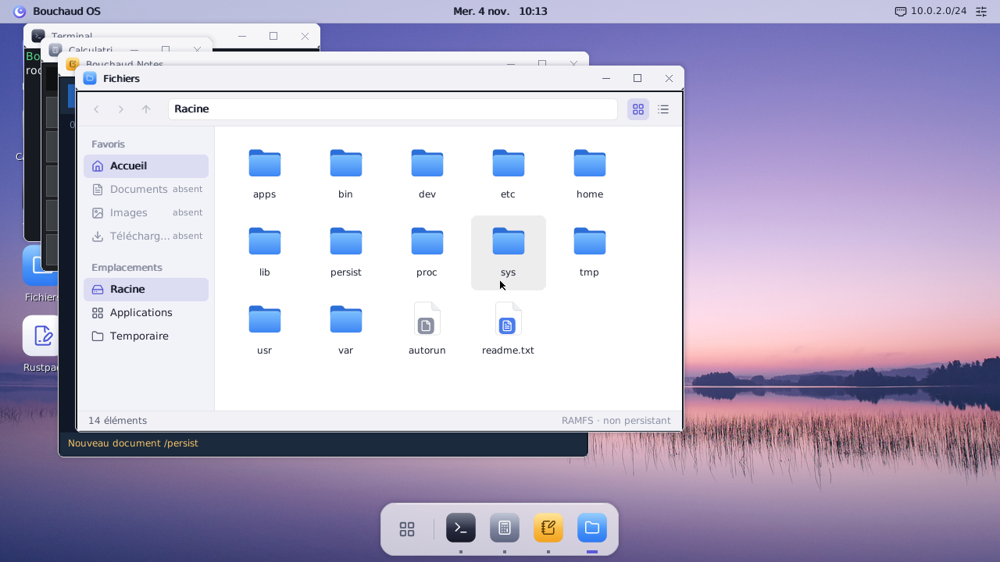
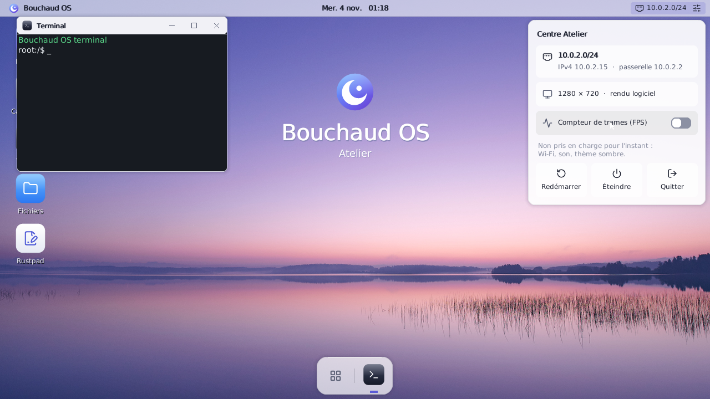
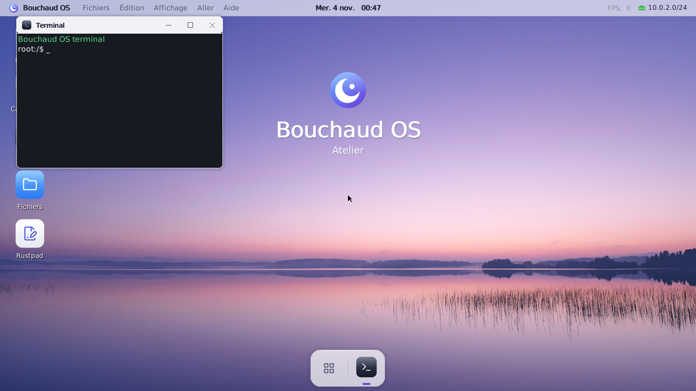
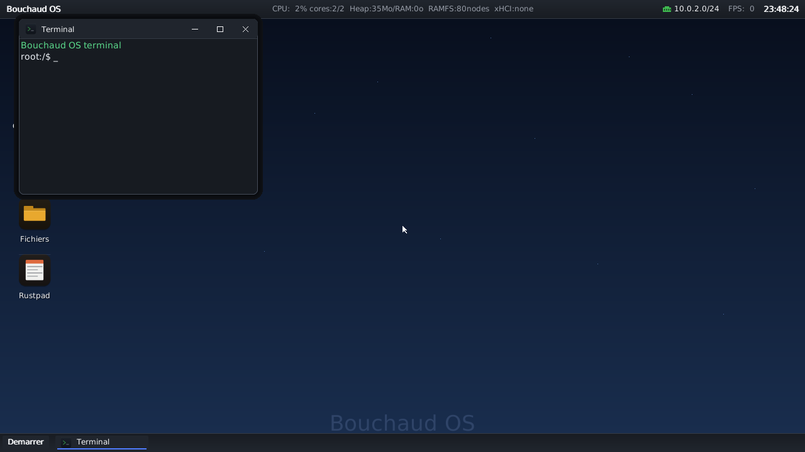
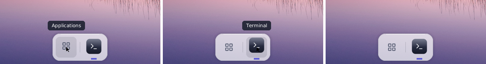
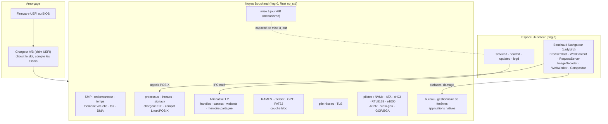

<div align="center">

# Bouchaud OS

**Souverain. Moderne. Durable.**

Un système d'exploitation natif expérimental, écrit principalement en Rust, avec son propre noyau x86_64.

[](https://github.com/bcharthur/bouchaud-os/actions/workflows/ci.yml)
[](https://github.com/bcharthur/bouchaud-os/actions/workflows/integration.yml)
[](https://github.com/bcharthur/bouchaud-os/actions/workflows/reliability-v3.yml)
[](https://github.com/bcharthur/bouchaud-os/actions/workflows/native-ipc-runtime.yml)
[](https://github.com/bcharthur/bouchaud-os/actions/workflows/ladybird-native-browser.yml)

</div>

> **Projet expérimental.** Bouchaud OS n'est pas un remplaçant de Windows, Linux ou macOS. Une fonctionnalité n'est annoncée qu'au niveau de preuve réellement obtenu : `HOST` (tests sur la machine de développement), `TCG` (QEMU émulé), `KVM` (QEMU accéléré) ou `PHYSICAL` (machine réelle). **Aucune campagne physique n'a été menée sur le code actuel** : tout ce qui suit est démontré au mieux sous QEMU.
>
> *English summary:* Bouchaud OS is an experimental, from-scratch x86_64 operating system written mostly in Rust (`no_std`). It has its own kernel, SMP scheduler, virtual memory, native IPC ABI, drivers, desktop and a Ladybird-based browser running in user space. It runs under QEMU; physical hardware validation of the current code has not started.

**Où lire l'état exact :** [`docs/current/status.json`](docs/current/status.json) est la source de vérité datée (SHA de `main`, verdicts, PR ouvertes). Ce README décrit le projet ; il ne recopie ni SHA de qualification ni verdict de CI.

## Sommaire

- [Le projet](#le-projet)
- [L'interface Atelier](#linterface-atelier)
- [Ce qui existe réellement](#ce-qui-existe-réellement)
- [Architecture](#architecture)
- [Construire et démarrer](#construire-et-démarrer)
- [Tests et CI](#tests-et-ci)
- [Limitations connues](#limitations-connues)
- [Travaux en cours et feuille de route](#travaux-en-cours-et-feuille-de-route)
- [Organisation du dépôt et contributions](#organisation-du-dépôt-et-contributions)
- [Licences et attributions](#licences-et-attributions)

---

## Le projet

Bouchaud OS est un système d'exploitation **bare-metal** : il démarre directement sur la machine (ou sur QEMU), sans Linux ni Windows en dessous. Le noyau, l'ordonnanceur, la mémoire virtuelle, les pilotes, le réseau, le système de fichiers et le bureau sont développés dans ce dépôt. Une couche de compatibilité Linux/POSIX permet d'y faire tourner des logiciels complexes, dont le moteur web Ladybird. C'est une interface de compatibilité, pas un noyau Linux caché.

**Philosophie**

- **Souverain** : chaque couche, du chargeur au bureau, est comprise, lue et modifiable ici. Les composants tiers sont identifiés, épinglés et attribués.
- **Moderne** : Rust `no_std`, SMP dès le départ, une ABI native à base de handles et d'IPC, des mises à jour atomiques A/B, un bureau conçu comme un produit.
- **Durable** : chaque comportement important a son banc de preuve, rejouable sur le même SHA. Un défaut corrigé laisse un test qui le reproduirait.

**Ambitions, non livrées** : une machine de référence physique pleinement prise en charge (TRIGKEY Speed S5), des services système isolés en espace utilisateur, un stockage généraliste fiable, l'accélération graphique, puis des services d'IA locale isolés. Ce sont des **directions** ; leur état réel est donné plus bas.

---

## L'interface Atelier

**Atelier Experience 2.0** est le nouveau bureau de Bouchaud OS. Il apporte un design system et de vrais assets : icônes [Lucide](https://lucide.dev), photographie de fond, logo provisoire. On y trouve une barre haute, un dock, un centre de contrôle et des fenêtres animées.

> **Statut : développé dans des PR ouvertes, pas encore sur `main`.** Toutes les images ci-dessous sont des **captures réelles du framebuffer sous QEMU**. Elles sont prises avec la commande `screendump` du moniteur, en 1280×720 et en rendu logiciel, par le banc `tools/ci/run_bureau_capture.sh` de ces PR. Ce ne sont pas des maquettes, et chaque image est liée au commit qui l'a produite.

<table>
<tr>
<td width="50%"></td>
<td width="50%"></td>
</tr>
<tr>
<td><sub><b>Fichiers Atelier</b> : barre latérale, fil d'Ariane, grille, état de persistance. PR #244, commit <code>07f1a5ff</code>.</sub></td>
<td><sub><b>Centre de contrôle</b> : états réels du réseau et de l'affichage, actions d'alimentation. PR #243, commit <code>cefad34a</code>.</sub></td>
</tr>
<tr>
<td></td>
<td></td>
</tr>
<tr>
<td><sub><b>Bureau Atelier 2.0</b> : design system, fond photographique, dock. PR #242, commit <code>f2cbb068</code>.</sub></td>
<td><sub><b>Le bureau disponible aujourd'hui sur <code>main</code></b> (<code>69e179a4</code>), pour comparaison.</sub></td>
</tr>
</table>

<p align="center"><br><sub>Survol du dock, image par image (PR #243, <code>cefad34a</code>).</sub></p>

Le rendu est **logiciel** : le pilote virtio-gpu sait présenter des images, mais aucun pixel n'est calculé par un GPU.

---

## Ce qui existe réellement

Légende : ✅ démontré à ce niveau · ◐ partiel · — non démontré · 🔀 seulement dans une PR ouverte.

La colonne « Physique » désigne un essai sur la machine de référence **avec le code actuel**. Des boots physiques plus anciens figurent dans l'historique, mais sur d'autres SHA : ils ne qualifient pas `main`.

| Composant | Sur `main` | Hôte | QEMU TCG | QEMU KVM | Physique | Remarques |
|---|:---:|:---:|:---:|:---:|:---:|---|
| Noyau x86_64 (démarrage BIOS et UEFI, IDT, APIC, horloges) | ✅ | ◐ | ✅ | ✅ | — | démarrage UEFI via le chargeur A/B (OVMF) |
| Mémoire virtuelle, pagination à la demande, tas compagnon, DMA | ✅ | ◐ | ✅ | ✅ | — | pas de swap |
| Processus, threads, signaux, `wait4`, futex | ✅ | ◐ | ✅ | ✅ | — | anomalie SIGCHLD multi-fils ouverte (voir limites) |
| Ordonnanceur SMP (files par cœur, IPI, préemption) | ✅ | ◐ | ✅ SMP1/2/4 | ✅ SMP1/2/4 | — | SMP8 strict en attente d'un runner dédié |
| ABI native 1.2 et IPC (handles, canaux, waitsets, mémoire partagée) | ✅ | ✅ | ✅ | — | — | contrat gelé et vérifié ; [NATIVE_ABI](docs/current/NATIVE_ABI.md) |
| Compatibilité Linux/POSIX (ELF, `ld.so`, appels système) | ✅ | ◐ | ✅ | ✅ | — | sert à porter Ladybird |
| Pilotes QEMU : NVMe, ATA, xHCI (HID, stockage BOT), e1000, AC'97, BGA, virtio-gpu 2D, PS/2, UART | ✅ | ◐ | ✅ | ◐ | — | |
| Pilotes du matériel de référence : RTL8111/8168, GOP UEFI, NVMe et xHCI réels | ✅ | — | — | — | — | code présent, **non revalidé physiquement** |
| Réseau : IPv4, ARP, DHCP, DNS, TCP/UDP, TLS, HTTP/1.1 et HTTP/2 | ✅ | ◐ | ✅ | ✅ | — | |
| Bureau et gestionnaire de fenêtres (dans le noyau), rendu logiciel | ✅ | ✅ | ✅ | — | — | damage tracking, culling de scène |
| Atelier Experience 2.0 (design system, dock, centre de contrôle, Fichiers) | 🔀 | ✅ | ✅ | — | — | PR #242 à #244 |
| Applications natives : Terminal, Fichiers, Notes, Calculatrice, Rustpad, Journal, Services, Insights, Infos système | ✅ | ◐ | ✅ | — | — | applications du noyau, pas des processus isolés |
| Bouchaud Navigateur (Ladybird, multiprocessus en ring 3) | ✅ | — | ✅ | ✅ | — | WebContent, RequestServer, ImageDecoder, WebWorker, Compositor |
| Services natifs ring 3 : `serviced`, `healthd`, `updated`, `logd` | ✅ | ◐ | ✅ SMP1/4 | — | — | supervision, santé, mise à jour, journal |
| Atomic Platform A/B : chargeur UEFI, essai, commit de santé, retour arrière, recovery | ✅ | ✅ | ✅ | — | — | manifeste Ed25519 ; **pas de clé de production ni d'anti-rollback** |
| Stockage : RAMFS, `/persist` transactionnel, GPT, FAT32 | ✅ | ✅ | ✅ | — | — | coupure de courant simulée sous TCG ; **pas de VFS disque généraliste** |
| Dossiers personnels persistants, écriture différée, métadonnées | 🔀 | ✅ | ✅ | — | — | PR #245 |
| Vidange réelle USB (commit A/B sur clé), liaison volume ↔ support | 🔀 | ✅ | ✅ | — | — | PR #246 |
| Diagnostic : boîte noire, profil RIP, BRDP, journal série, console de recovery | ✅ | ◐ | ✅ | ◐ | — | |

Le détail des verdicts (Atomic Platform, P13, anomalies ouvertes) est dans [`status.json`](docs/current/status.json) et [`STATUS_CURRENT.md`](docs/current/STATUS_CURRENT.md).

---

## Architecture



**Ce qui s'exécute où.** Tout ce qui figure dans le bloc *Noyau* tourne en ring 0. C'est le cas aujourd'hui du bureau, du gestionnaire de fenêtres, des applications natives et de la pile réseau. C'est une dette connue, et l'isolation progressive des services en ring 3 est un chantier ouvert. Le navigateur et les quatre services natifs sont en revanche de vrais processus en ring 3, avec leur propre espace d'adressage.

- **Amorçage.** Il existe deux chemins. L'image BIOS (`bootimage`) est utilisée par la plupart des bancs. L'image UEFI passe par le chargeur A/B, qui lit les métadonnées, choisit un slot, consomme un essai et passe la main au noyau ([UPDATE_RECOVERY](docs/current/UPDATE_RECOVERY.md)).
- **Noyau.** SMP avec APIC local, files d'exécution par cœur et IPI. Mémoire virtuelle avec pagination à la demande. Processus et threads POSIX, et une ABI native à base de handles pour les nouveaux programmes ([NATIVE_ABI](docs/current/NATIVE_ABI.md)).
- **Pilotes.** Ils sont exposés derrière des API de bus et de bloc communes. Les pilotes du matériel de référence (RTL8168, NVMe et xHCI réels) existent, mais attendent leur revalidation physique.
- **Système de fichiers.** Le système de fichiers vivant est en mémoire (RAMFS). `/persist` est une zone de disque écrite par transactions A/B résistantes aux coupures. Il n'y a pas encore de VFS disque généraliste avec cache de pages unifié.
- **Environnement graphique.** Le bureau compose ses calques en logiciel, région endommagée par région endommagée. Il présente le résultat par copie vers le framebuffer (GOP, BGA ou virtio-gpu 2D).
- **Navigateur.** Ladybird, épinglé et patché, tourne en plusieurs processus ring 3 au-dessus de la compatibilité POSIX. Son Compositor livre des surfaces au gestionnaire de fenêtres ([BOUCHAUD_NAVIGATEUR](docs/current/BOUCHAUD_NAVIGATEUR.md)).
- **Mises à jour et récupération.**
  - `updated` (ring 3, capacité dédiée) installe un slot à partir d'un manifeste signé.
  - `serviced` déclare la santé du système, et le noyau ne valide le slot qu'à ce moment-là.
  - Sans déclaration de santé, le chargeur revient au slot précédent après trois essais.
  - Une console de recovery reste accessible.

Plus de détail : [ARCHITECTURE_CURRENT](docs/current/ARCHITECTURE_CURRENT.md), [ARCHITECTURE_PRODUCT_TRUTH](docs/current/ARCHITECTURE_PRODUCT_TRUTH.md).

---

## Construire et démarrer

### Prérequis

- Linux x86_64 ou WSL2 sous Windows, avec `git`, `python3`, `qemu-system-x86_64` (version 8 ou plus) et `ovmf` pour l'UEFI.
- [rustup](https://rustup.rs). La toolchain nightly exacte est épinglée dans [`rust-toolchain.toml`](rust-toolchain.toml) et s'installe automatiquement, avec `rust-src` et `llvm-tools-preview`.
- `cargo-bootimage`, que le script de construction installe s'il manque.

### Compiler et démarrer sous QEMU (BIOS)

```bash
git clone https://github.com/bcharthur/bouchaud-os.git
cd bouchaud-os
tools/ci/build_kernel.sh            # produit target/x86_64-bouchaud_os/debug/bootimage-bouchaud-os.bin
qemu-system-x86_64 -m 2048 -smp 2 -serial stdio \
  -drive format=raw,file=target/x86_64-bouchaud_os/debug/bootimage-bouchaud-os.bin
```

Le noyau démarre jusqu'à l'écran de connexion, puis jusqu'au shell. La commande `desktop` lance le bureau. Le journal du noyau sort sur la console série (`-serial stdio`, ou `-serial file:serie.log`).

Sous Windows, `run.ps1` construit et lance une configuration complète, avec le bureau et le runtime Ladybird :

```powershell
.\run.ps1
```

### Image UEFI

Le noyau UEFI se compile avec :

```bash
cargo build --target targets/x86_64-bouchaud_os_uefi.json --no-default-features --features uefi-boot,reference-desktop
```

L'image A/B complète (chargeur, deux slots, métadonnées) n'est aujourd'hui produite et démarrée que par le banc [`tools/ci/run_ab_rollback.sh`](tools/ci/run_ab_rollback.sh), sous QEMU et OVMF. C'est aussi la meilleure documentation exécutable du chemin UEFI.

### Image pour la machine physique

```bash
tools/release/build_trigkey_image.sh out/trigkey
sha256sum -c out/trigkey/bouchaud-trigkey.img.sha256
```

Le script refuse un arbre de travail sale. Il produit :
- l'image et son empreinte ;
- le noyau ELF non strippé, nécessaire pour symboliser une panne ;
- un `manifest.json` qui relie l'image au commit.

Sous Windows, l'équivalent est `tools/reference/IMAGE-TRIGKEY.ps1`, et l'image se teste d'abord sous QEMU :

```powershell
.\tools\reference\run-trigkey-single-usb-qemu.ps1 -Accel tcg -SkipBuild
```

> **⚠ Écriture sur disque.** Une image se flashe en mode DD : la clé cible est **intégralement écrasée**. Ne choisissez jamais le disque interne de la machine comme cible.
>
> **L'installation et le démarrage physiques ne sont pas validés sur le code actuel.** [TRIGKEY_CAMPAIGN](docs/current/TRIGKEY_CAMPAIGN.md) décrit le protocole, qui n'a pas encore été exécuté. L'image actuelle n'embarque pas encore les services natifs A/B (`serviced`, `healthd`, `updated`, `logd`).

### Journaux et diagnostic

- **Console série** : tous les marqueurs de preuve (`BOUCHAUD_…`) y sont publiés, et les bancs ne lisent rien d'autre.
- **Boîte noire** : sur une machine réelle sans câble série, le journal est écrit sur la clé.
  - Extraction : `tools/reference/extract-blackbox.py --image <clé>`.
  - Symbolisation : `tools/reference/symbolise-blackbox.py`, avec le `kernel.elf` de la même image.
- **Commandes du shell** : `hwinfo`, `lsusb`, `usbetat`, `netdiag`, `bootlog`, `services`, `diag-save`.

---

## Tests et CI

Une preuve vaut pour **un SHA** et **un niveau**. Un PASS sous QEMU TCG ne dit rien de KVM, et aucun des deux ne dit rien du matériel : une CI verte n'est **pas** une preuve physique.

| Famille | Où | Quand | Ce qu'elle établit |
|---|---|---|---|
| Tests hôte | `tools/**/test_*.rs`, lancés par `tools/ci/run_host_tests.sh` | local, CI | la logique pure (décodeurs, politiques, A/B, rendu), incluse **telle quelle** depuis `src/` |
| Garde-fous d'architecture | `tools/ci/run_architecture_guards.sh` (`tools/verifie-*.py`) | local, CI | invariants de code, contrats d'ABI, interdits, avec leurs témoins négatifs |
| CI Fast | `ci.yml` | push, PR | construction, garde-fous, tests hôte : le contrôle court |
| Integration | `integration.yml` | push, PR | démarrages QEMU, stockage, réseau, USB |
| Reliability V3 | `reliability-v3.yml` | push, PR, chaque nuit | matrice de fiabilité, coupures, injections de pannes |
| Native IPC Runtime | `native-ipc-runtime.yml` | push, PR (filtré par chemins) | ABI native, services ring 3, matrice A/B de `run_ab_rollback.sh` |
| Security Runtime | `security-runtime.yml` | push, PR | tests négatifs : l'interdit échoue, l'autorisé passe |
| Ladybird | `ladybird-native-browser.yml`, `ladybird-sync.yml` | push, PR, chaque jour | construction du navigateur, WPT, sites, robustesse, endurance |
| P13 primitives | `p13-primitives-noyau.yml`, `p13-cible-kvm.yml` | push, PR | primitives du noyau sous TCG et KVM (SMP1/2/4) |
| P13 strict | `p13-dedicated-kvm.yml`, `p13-final-candidate.yml` | manuel | qualification sur runners KVM4/KVM8 dédiés (**bloquée** : runners non enregistrés) |
| Nightly, endurance, soak | `nightly.yml`, `endurance.yml`, `soak.yml` | nuit, semaine, manuel | campagnes longues |

Avant de pousser, la barrière locale rejoue l'essentiel :

```bash
tools/ci/run_host_tests.sh
tools/ci/run_architecture_guards.sh
tools/ci/run_barriere_locale.sh
```

**Lire un résultat.**
- `PASS` signifie que la preuve nommée a tourné et qu'elle est verte, au niveau indiqué.
- `skipped`, `cancelled`, `NON_QUALIFYING` ou une preuve absente ne sont **pas** des PASS.
- Pour un `pull_request`, GitHub teste un commit de fusion synthétique, qu'il faut distinguer de la tête de branche.

Le détail est dans [CI_AND_PROOFS](docs/current/CI_AND_PROOFS.md).

---

## Limitations connues

| Domaine | État |
|---|---|
| Matériel physique | campagne Trigkey **non commencée** sur le code actuel ; Wi-Fi, Bluetooth, HDA, gestion d'énergie et suspend non pris en charge |
| Stockage | pas de VFS disque généraliste, pas de cache de pages unifié, pas de `mmap` en écriture sur un fichier disque ; `/persist` réécrit sa table entière à chaque transaction |
| Isolation | le bureau, les applications natives, le réseau et TLS tournent encore dans le noyau |
| Graphique | rendu logiciel uniquement ; aucune accélération GPU, ni 3D, ni pilote AMD |
| Mises à jour | pas de clé de version de production, pas de politique anti-retour arrière |
| Qualification | P13 strict bloqué faute de runners KVM4/KVM8 dédiés ; `main` sans protection de branche |
| Anomalies ouvertes | `SIGCHLD_MULTIFIL_ECHEC` (une occurrence, non reproduite en 125 essais) ; une panique SMP4 dans un banc de comptabilité |

Liste complète et priorités : [KNOWN_LIMITATIONS](docs/current/KNOWN_LIMITATIONS.md).

---

## Travaux en cours et feuille de route

**Pull requests ouvertes**, état au 2026-11-04, à revérifier sur GitHub. Les PR #242 à #247, sauf #246, sont empilées : chacune contient la précédente.

| PR | Sujet |
|---|---|
| [#242](https://github.com/bcharthur/bouchaud-os/pull/242) | Atelier Experience 2.0 : design system, assets réels, dock, fenêtres |
| [#243](https://github.com/bcharthur/bouchaud-os/pull/243) | Atelier A/B/C : barre haute réelle, centre de contrôle, animations, dock interactif |
| [#244](https://github.com/bcharthur/bouchaud-os/pull/244) | Atelier D1 : application Fichiers |
| [#245](https://github.com/bcharthur/bouchaud-os/pull/245) | Stockage S1 : dossiers personnels persistants, écriture différée, métadonnées |
| [#246](https://github.com/bcharthur/bouchaud-os/pull/246) | Trigkey T1 : vidange réelle USB et commit A/B sur clé (indépendante) |
| [#247](https://github.com/bcharthur/bouchaud-os/pull/247) | Performance P1 : première trame du bureau −1,9 s |

**Chantiers ouverts**, par ordre de priorité. Ce sont des projets, pas des fonctionnalités livrées.

| Chantier | Objectif |
|---|---|
| P13 strict | runners KVM4/KVM8 dédiés, qualification sur un SHA unique, endurance de 30 min |
| Stockage généraliste et VFS | inodes, montages, cache de pages, `read`/`write`/`mmap` cohérents, `fsync`, volumes externes, journalisation |
| Plateforme Trigkey | démarrage physique, USB, NVMe, réseau, audio, horloges, énergie, endurance, diagnostics reproductibles |
| Performance mesurée | latence des interactions, coût de l'IPC, copies, allocations, temps de chargement |
| Moteur graphique | composition CPU optimisée, présentation GPU 2D, puis étude de la 3D et du GPU AMD |
| Runtime applicatif isolé | applications et services hors du noyau, contrats IPC, supervision |
| Pilotes matériels | HDA, Wi-Fi, gestion d'énergie, isolation DMA |
| Sécurité de production | clé de version hors ligne, anti-retour arrière, protection de `main` |
| Installation physique | installateur et mise à jour sur le disque interne, après la campagne physique |
| Plus tard | IA locale comme service isolé, conteneurs, modes d'usage |

Feuille de route détaillée : [ROADMAP_CURRENT](docs/current/ROADMAP_CURRENT.md).

---

## Organisation du dépôt et contributions

| Chemin | Contenu |
|---|---|
| `src/arch/x86_64/` | démarrage, interruptions, APIC, SMP, PCI, passage en ring 3 |
| `src/kernel/` | mémoire, processus et threads, ordonnanceur, ABI native, services, mise à jour A/B |
| `src/compat/linux/` | personnalité Linux/POSIX |
| `src/drivers/` | pilotes (bloc, réseau, USB, affichage, audio, entrées, série) |
| `src/fs/`, `src/net/` | systèmes de fichiers et persistance ; pile réseau |
| `src/gui/` | bureau, gestionnaire de fenêtres, applications natives |
| `userland/` | services ring 3 et `bouchaud-sdk` |
| `system/update-core/` | politique A/B partagée par le chargeur et le noyau |
| `tools/` | bancs QEMU (`tools/ci/`), tests hôte, garde-fous, Ladybird, images |
| `docs/current/` | documentation courante ; `docs/history/` et `docs/historique/` contiennent les archives |

**Conventions**

- Une PR par incrément, avec ses preuves (tests hôte, banc QEMU, garde-fous) au même SHA. Pas de push direct sur `main`.
- Un comportement important porte un marqueur (`BOUCHAUD_…_V1`), dans le code et dans le banc qui le vérifie.
- Un garde-fou s'accompagne d'un témoin négatif : la mutation qu'il doit refuser.
- On ne relâche ni un seuil ni un garde-fou pour faire passer un test. Un rouge est attribué avant d'être corrigé.
- Le code et les commentaires sont rédigés en français.

Pour reprendre le projet : [`docs/current/README.md`](docs/current/README.md).

---

## Licences et attributions

Le code de Bouchaud OS est publié sous **double licence MIT ou Apache-2.0**, au choix ([`LICENSE`](LICENSE), [`LICENSE-MIT`](LICENSE-MIT), [`LICENSE-APACHE`](LICENSE-APACHE)). Cette licence ne s'applique pas aux composants tiers, qui gardent la leur :

- **Ladybird** (BSD 2-Clause), épinglé et patché, ainsi que ses dépendances (ICU, OpenSSL, Skia, HarfBuzz, FreeType…) : voir [`THIRD_PARTY_NOTICES.md`](THIRD_PARTY_NOTICES.md) et [`THIRD_PARTY_LICENSES/`](THIRD_PARTY_LICENSES/).
- **Crates Rust** du noyau (fontdue, smoltcp, wasmi, hashbrown, x86_64…) : licences permissives, recensées dans les notices.
- **Polices DejaVu** : licence Bitstream Vera / DejaVu.
- **Atelier**, dans les PR #242 et suivantes :
  - icônes [Lucide](https://lucide.dev) (ISC) ;
  - photographie de fond « summer 1am » de Risto Saukonpää (LGPL-3.0, KDE plasma-workspace-wallpapers) ;
  - sous-ensemble de DejaVu Sans.

  Leurs attributions et le manifeste des assets arrivent avec ces PR (`assets/atelier/ATTRIBUTIONS.md`). Le logo Bouchaud OS est **provisoire**.
